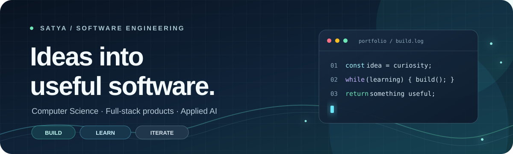
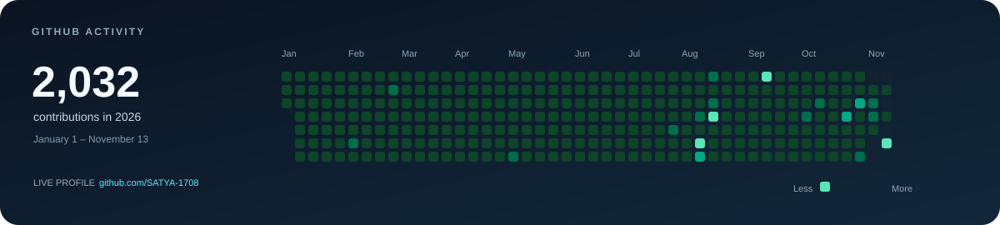

  

    

  <h1>Hi, I'm Satya 👋</h1>

  

    <strong>B.Tech Computer Science Engineering &bull; Class of 2028</strong> 
    <em>Full-Stack Software Engineer &bull; Cloud & Backend Systems &bull; Applied AI</em>
  

  

    
    
  

---

### 👨‍💻 About Me

- 🎓 **Undergraduate Student** pursuing a B.Tech in Computer Science Engineering (Graduating 2028).
- 🚀 **Full-Stack & Systems Builder** crafting production-ready architectures from responsive frontend interfaces down to high-performance database layers.
- 💡 **Passionate about**: Distributed architectures, robust REST APIs, clean UI/UX, and data-informed decision systems.
- 🎯 **Recent Focus**: Enterprise Spring Boot & microservices, React SPA architectures, geospatial tools, and practical LLM/AI integrations.

---

### 🛠 Tech Stack & Tools

  

<strong>Categorized Skills</strong>

 

| Domain | Technologies |
| :--- | :--- |
| **Languages** | Java, Python, TypeScript, JavaScript, C++, SQL |
| **Backend & Frameworks** | Spring Boot, Spring Data JPA, Hibernate, FastAPI, Node.js, Express |
| **Frontend Development** | React, Vite, Tailwind CSS, HTML5, CSS3, JavaScript (ES6+) |
| **Databases & ORM** | MySQL, PostgreSQL, MongoDB, Supabase, Hibernate |
| **Tools & Platforms** | Git, GitHub, Docker, Postman, Maven, REST APIs |

---

### 🌟 Featured Projects

<table>
  <tr>
    <td width="50%" valign="top">
      <a href="https://github.com/SATYA-1708/StudentManagement">
        <h3>🎓 Student Management System</h3>
      </a>
      
Production-grade RESTful API built with <strong>Spring Boot 3</strong>, <strong>Spring Data JPA</strong>, and <strong>MySQL 8.0</strong> paired with a modern <strong>React 18</strong> SPA dashboard. Features complete CRUD operations, bean validation, custom global exception handling, and full Postman test coverage.

      
<code>Java 17</code> &bull; <code>Spring Boot 3</code> &bull; <code>MySQL</code> &bull; <code>React</code> &bull; <code>Tailwind</code> &bull; <code>Postman</code>

    </td>
    <td width="50%" valign="top">
      <a href="https://github.com/SATYA-1708/AquaShift">
        <h3>🌱 AquaShift</h3>
      </a>
      
Agricultural decision-support platform featuring a <strong>FastAPI</strong> backend and reactive <strong>React</strong> interface for geospatial crop planning, irrigation analytics, and dynamic weather integration.

      
<code>Python</code> &bull; <code>FastAPI</code> &bull; <code>React</code> &bull; <code>Leaflet Maps</code> &bull; <code>Analytics</code>

    </td>
  </tr>
  <tr>
    <td width="50%" valign="top">
      <a href="https://github.com/SATYA-1708/Railway">
        <h3>🚆 RailFlow AI</h3>
      </a>
      
Intelligent rail operations and scheduling prototype combining Python predictive services, real-time data adapters, and an interactive operational dashboard for delay prevention and ETA estimation.

      
<code>Python</code> &bull; <code>Machine Learning</code> &bull; <code>FastAPI</code> &bull; <code>React</code>

    </td>
    <td width="50%" valign="top">
      <a href="https://github.com/SATYA-1708/MahaKisan">
        <h3>🌾 MahaKisan</h3>
      </a>
      
Smart crop-surveillance and risk-mitigation platform designed to assess agricultural risks, track disease outbreaks, and provide actionable interventions for farmers.

      
<code>Python</code> &bull; <code>React</code> &bull; <code>Data Science</code> &bull; <code>REST APIs</code>

    </td>
  </tr>
  <tr>
    <td width="50%" valign="top">
      <a href="https://github.com/SATYA-1708/E-commerce-Jewellary">
        <h3>💎 Jewellery E-Commerce</h3>
      </a>
      
Full-stack modern storefront built with <strong>TypeScript</strong> and <strong>Supabase</strong>, featuring dynamic product filtering, shopping cart workflows, user authentication, and secure checkout simulation.

      
<code>TypeScript</code> &bull; <code>React</code> &bull; <code>Supabase</code> &bull; <code>PostgreSQL</code>

    </td>
    <td width="50%" valign="top">
      <a href="https://github.com/SATYA-1708/SIH-2026">
        <h3>♻️ E-Waste Setu</h3>
      </a>
      
Smart India Hackathon project connecting e-waste generators with verified recyclers through automated pickup dispatching, lifecycle tracking, and recycling incentives.

      
<code>Full-Stack</code> &bull; <code>Workflow Automation</code> &bull; <code>Hackathon</code>

    </td>
  </tr>
</table>

---

### 📊 GitHub Activity & Metrics

  
  

    

  

    

  

---

  
<em>"Always building, always optimizing."</em>

  
💬 Feel free to reach out via <a href="mailto:bhagavansunkara12@gmail.com"><strong>Email</strong></a> or explore my repositories above!

